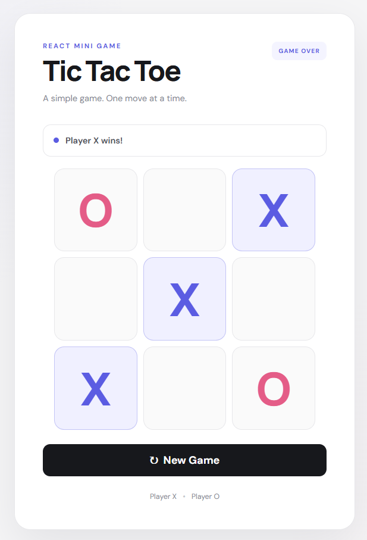

# Tic Tac Toe 🎮

A simple **Tic Tac Toe game built with React**. The project focuses on clean UI, responsive design, and simple game logic.

> **Note:** This is a late push of the project, but it has been completed and added to the portfolio for documentation and future reference.

## ✨ Features

* Two-player gameplay
* X and O turn indicator
* Automatic win detection
* Draw detection
* Highlights the winning combination
* New Game button
* Responsive design
* Clean and minimal UI

## 🛠️ Built With

* React
* JavaScript
* CSS
* Vite

## 📸 Screenshot



## 🚀 Getting Started

### 1. Install dependencies

```bash
npm install
```

### 2. Start the development server

```bash
npm run dev
```

Open the local URL shown in the terminal.


## 📁 Project Structure

```text
tic-tac-toe-react/
├── src/
│   ├── main.jsx
│   └── style.css
├── screenshot/
│   ├── tictactoe.png
├── index.html
├── package.json
└── README.md
```

## 🎯 Purpose

This project was built as a small React practice project to understand component-based UI, state management, event handling, and conditional rendering.
